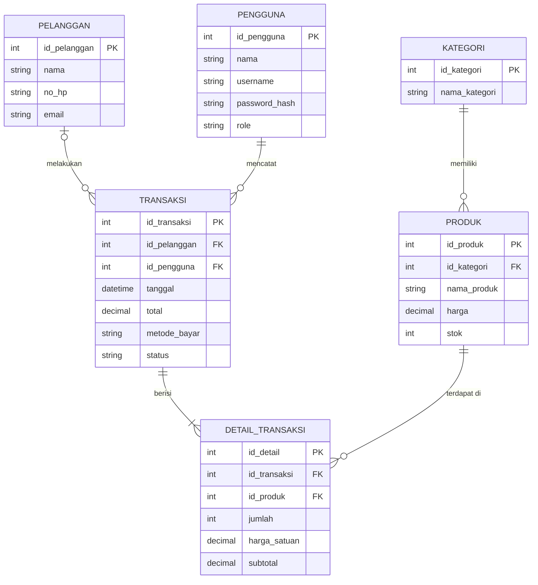
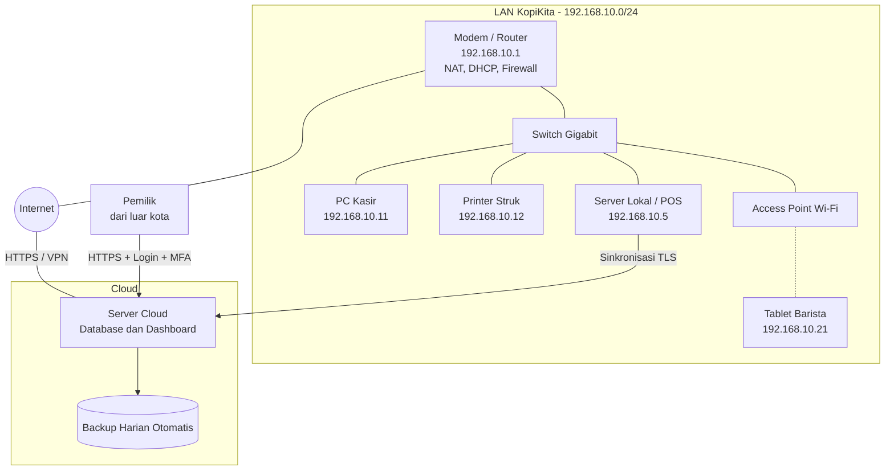
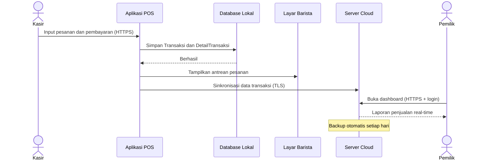
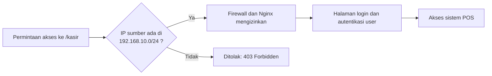

# ☕ Sistem Informasi Manajemen Kafe "KopiKita Cloud"

Dokumen jawaban studi kasus sistem informasi terintegrasi untuk kafe KopiKita.
Diagram ditulis dengan **Mermaid**, sehingga tampil otomatis di GitHub.

## Daftar Isi

1. [Tujuan Utama Sistem](#1-tujuan-utama-sistem)
2. [Komponen Sistem Informasi](#2-komponen-sistem-informasi)
3. [Manfaat bagi Pemilik](#3-manfaat-bagi-pemilik)
4. [Spesifikasi Hardware Minimal](#4-spesifikasi-hardware-minimal)
5. [Software Sistem dan Aplikasi](#5-software-sistem-dan-aplikasi)
6. [Peran Sistem Operasi dan Web Server](#6-peran-sistem-operasi-dan-web-server)
7. [Desain Database](#7-desain-database)
8. [Hubungan Antar Tabel (ERD)](#8-hubungan-antar-tabel-erd)
9. [Arsitektur Jaringan LAN](#9-arsitektur-jaringan-lan)
10. [Pembatasan Akses dengan IP Private](#10-pembatasan-akses-dengan-ip-private)
11. [Protokol Komunikasi dan Keamanan Jaringan](#11-protokol-komunikasi-dan-keamanan-jaringan)

---

## Studi Kasus

KopiKita masih mencatat pesanan secara manual dan memakai Excel sederhana untuk laporan keuangan. Pemilik ingin sistem digital yang:

- dapat digunakan kasir dan barista di lokasi kafe,
- menyediakan pemantauan penjualan **real-time** bagi pemilik, bahkan saat di luar kota,
- menyimpan data transaksi di **server cloud** dengan **backup otomatis harian**,
- hanya dapat diakses kasir melalui **jaringan internal kafe (private IP)**.

---

## 1. Tujuan Utama Sistem

| No | Tujuan | Penjelasan |
|----|--------|------------|
| 1 | Digitalisasi pencatatan | Mengganti catatan manual dan Excel dengan sistem terstruktur dan akurat |
| 2 | Efisiensi operasional | Pesanan dari kasir langsung tampil di barista tanpa catatan kertas |
| 3 | Monitoring real-time | Pemilik memantau omzet dan penjualan dari mana saja |
| 4 | Keamanan dan ketersediaan data | Data tersimpan di cloud dengan backup otomatis harian |
| 5 | Kontrol akses | Kasir hanya bisa masuk lewat jaringan internal kafe |
| 6 | Dukungan keputusan bisnis | Laporan penjualan dan stok membantu perencanaan menu, harga, dan promo |

---

## 2. Komponen Sistem Informasi

| Komponen | Pada Kasus KopiKita |
|----------|---------------------|
| **People** | Pemilik, kasir, barista, pelanggan, administrator/teknisi IT |
| **Hardware** | PC/tablet kasir, tablet/monitor barista, printer struk, router, switch, server lokal, server cloud |
| **Software** | OS, web server, DBMS, aplikasi POS, dashboard pemilik, aplikasi pemesanan online |
| **Data** | Menu/produk, harga, stok, transaksi, pelanggan, laporan keuangan, akun pengguna |
| **Procedure** | SOP input pesanan, pembayaran, tutup kasir harian, backup, pengelolaan hak akses |
| **Network** | LAN kafe (private IP), internet, koneksi ke cloud, VPN/HTTPS untuk akses pemilik |

---

## 3. Manfaat bagi Pemilik

1. **Monitoring real-time**: omzet, menu terlaris, dan jam ramai terpantau dari jarak jauh.
2. **Laporan keuangan akurat dan otomatis**: mengurangi salah hitung dan manipulasi data.
3. **Data aman**: backup harian otomatis, data tidak hilang walau perangkat kafe rusak.
4. **Kontrol dan pencegahan kecurangan**: setiap transaksi tercatat per kasir.
5. **Efisiensi biaya dan waktu**: pencatatan, rekap, dan pengecekan stok lebih cepat.
6. **Dasar keputusan bisnis**: tren penjualan membantu menentukan stok, promo, dan harga.

---

## 4. Spesifikasi Hardware Minimal

### a. Server Lokal (opsional, untuk kasir)

| Komponen | Spesifikasi Minimal |
|----------|---------------------|
| CPU | Quad-core (Intel Core i3 / Xeon E / Ryzen 3) |
| RAM | 8 GB |
| Storage | SSD 256 GB (idealnya RAID 1) |
| Network | NIC Gigabit Ethernet |
| Pendukung | UPS untuk antisipasi listrik padam |

### b. Perangkat Client

| Perangkat | Spesifikasi Minimal |
|-----------|---------------------|
| **Kasir** | PC/laptop dual-core (i3 atau setara), RAM 4 GB, SSD 128 GB, layar 14-15" |
| Periferal kasir | Printer thermal 58/80 mm, barcode scanner, cash drawer |
| **Barista** | Tablet 8-10" (RAM 3 GB) atau monitor kecil + mini PC untuk antrean pesanan |

### c. Infrastruktur Jaringan Lokal

| Perangkat | Spesifikasi Minimal |
|-----------|---------------------|
| Router/modem | Port Gigabit, firewall, NAT, DHCP |
| Switch | Gigabit 8 port (unmanaged atau managed) |
| Access Point | Wi-Fi 5/6 dengan WPA2/WPA3 |
| Kabel | UTP Cat5e/Cat6 |

---

## 5. Software Sistem dan Aplikasi

### Software Sistem

| Kategori | Contoh |
|----------|--------|
| Sistem operasi | Ubuntu Server (server), Windows 10/11 atau Linux (kasir), Android (tablet) |
| DBMS | MySQL/MariaDB atau PostgreSQL |
| Web server | Nginx atau Apache |
| Keamanan dan utilitas | Firewall (UFW), antivirus, cron + rsync untuk backup, browser |

### Software Aplikasi

| Aplikasi | Fungsi |
|----------|--------|
| POS (berbasis web) | Input pesanan dan pembayaran oleh kasir |
| Barista Display | Menampilkan antrean pesanan |
| Dashboard pemilik | Laporan penjualan real-time |
| Modul laporan keuangan dan stok | Rekap harian/bulanan dan kontrol stok |
| Pemesanan online | Pesan dari pelanggan (opsional dengan payment gateway) |

---

## 6. Peran Sistem Operasi dan Web Server

**Sistem operasi**
- Mengelola sumber daya (CPU, memori, disk, jaringan).
- Menjalankan layanan database dan web server.
- Mengatur hak akses file dan user.
- Menyediakan keamanan dasar (firewall, update) dan penjadwalan backup.

**Web server**
- Menerima permintaan HTTP/HTTPS dari browser kasir, barista, dan pemilik.
- Meneruskan permintaan ke aplikasi dan database, lalu mengirim hasilnya kembali.
- Menangani SSL/TLS agar komunikasi terenkripsi.
- Membatasi akses berdasarkan alamat IP (misalnya hanya jaringan internal).

---

## 7. Desain Database

| Tabel | Kolom |
|-------|-------|
| **Pelanggan** | **id_pelanggan (PK)**, nama, no_hp, email |
| **Pengguna** | **id_pengguna (PK)**, nama, username, password_hash, role |
| **Kategori** | **id_kategori (PK)**, nama_kategori |
| **Produk** | **id_produk (PK)**, id_kategori (FK), nama_produk, harga, stok |
| **Transaksi** | **id_transaksi (PK)**, id_pelanggan (FK, boleh NULL), id_pengguna (FK), tanggal, total, metode_bayar, status |
| **DetailTransaksi** | **id_detail (PK)**, id_transaksi (FK), id_produk (FK), jumlah, harga_satuan, subtotal |

### Skrip SQL (MySQL/MariaDB)

```sql
CREATE TABLE Pelanggan (
    id_pelanggan INT AUTO_INCREMENT PRIMARY KEY,
    nama         VARCHAR(100) NOT NULL,
    no_hp        VARCHAR(20),
    email        VARCHAR(100)
);

CREATE TABLE Pengguna (
    id_pengguna   INT AUTO_INCREMENT PRIMARY KEY,
    nama          VARCHAR(100) NOT NULL,
    username      VARCHAR(50)  NOT NULL UNIQUE,
    password_hash VARCHAR(255) NOT NULL,
    role          ENUM('kasir','barista','pemilik') NOT NULL
);

CREATE TABLE Kategori (
    id_kategori   INT AUTO_INCREMENT PRIMARY KEY,
    nama_kategori VARCHAR(50) NOT NULL
);

CREATE TABLE Produk (
    id_produk   INT AUTO_INCREMENT PRIMARY KEY,
    id_kategori INT NOT NULL,
    nama_produk VARCHAR(100) NOT NULL,
    harga       DECIMAL(10,2) NOT NULL,
    stok        INT NOT NULL DEFAULT 0,
    FOREIGN KEY (id_kategori) REFERENCES Kategori(id_kategori)
);

CREATE TABLE Transaksi (
    id_transaksi INT AUTO_INCREMENT PRIMARY KEY,
    id_pelanggan INT NULL,
    id_pengguna  INT NOT NULL,
    tanggal      DATETIME NOT NULL DEFAULT CURRENT_TIMESTAMP,
    total        DECIMAL(12,2) NOT NULL,
    metode_bayar ENUM('tunai','qris','kartu') NOT NULL,
    status       ENUM('baru','diproses','selesai','batal') NOT NULL DEFAULT 'baru',
    FOREIGN KEY (id_pelanggan) REFERENCES Pelanggan(id_pelanggan),
    FOREIGN KEY (id_pengguna)  REFERENCES Pengguna(id_pengguna)
);

CREATE TABLE DetailTransaksi (
    id_detail    INT AUTO_INCREMENT PRIMARY KEY,
    id_transaksi INT NOT NULL,
    id_produk    INT NOT NULL,
    jumlah       INT NOT NULL,
    harga_satuan DECIMAL(10,2) NOT NULL,
    subtotal     DECIMAL(12,2) NOT NULL,
    FOREIGN KEY (id_transaksi) REFERENCES Transaksi(id_transaksi),
    FOREIGN KEY (id_produk)    REFERENCES Produk(id_produk)
);
```

---

## 8. Hubungan Antar Tabel (ERD)



**Penjelasan relasi**

| Relasi | Kardinalitas | Keterangan |
|--------|--------------|------------|
| Kategori → Produk | 1 : N | Satu kategori memiliki banyak produk |
| Pelanggan → Transaksi | 1 : N (opsional) | Satu pelanggan bisa punya banyak transaksi, transaksi tanpa akun tetap bisa dicatat (FK NULL) |
| Pengguna → Transaksi | 1 : N | Satu kasir mencatat banyak transaksi |
| Transaksi → DetailTransaksi | 1 : N | Satu transaksi berisi banyak item |
| Produk → DetailTransaksi | 1 : N | Satu produk dapat muncul di banyak detail transaksi |
| Transaksi ↔ Produk | M : N | Dipecah oleh tabel **DetailTransaksi** |

---

## 9. Arsitektur Jaringan LAN



**Alur transaksi:**



---

## 10. Pembatasan Akses dengan IP Private

### Mekanisme

1. **Alamat private** (`10.0.0.0/8`, `172.16.0.0/12`, `192.168.0.0/16`) tidak dapat dirutekan di internet publik, sehingga server kasir yang hanya memakai IP ini tidak terjangkau dari luar.
2. **NAT di router**: perangkat internal keluar ke internet lewat satu IP publik, dan **tidak ada port forwarding** ke server kasir.
3. **Aturan firewall dan web server**: hanya subnet `192.168.10.0/24` yang diizinkan.
4. **Penguatan tambahan**: DHCP reservation (IP tetap untuk tiap perangkat kasir), MAC filtering, dan VLAN terpisah antara jaringan kasir dan Wi-Fi pelanggan.
5. **Pemilik tidak melewati jalur ini**; ia memakai dashboard cloud dengan HTTPS, login, dan idealnya VPN dan MFA.

### Alur keputusan akses



### Contoh konfigurasi

**Nginx**

```nginx
location /kasir {
    allow 192.168.10.0/24;
    deny  all;
}
```

**UFW (firewall Ubuntu)**

```bash
sudo ufw default deny incoming
sudo ufw allow from 192.168.10.0/24 to any port 443 proto tcp
sudo ufw allow from 192.168.10.0/24 to any port 22 proto tcp
sudo ufw enable
```

> **Catatan:** IP private bukan satu-satunya pengaman. Kombinasikan dengan autentikasi, firewall, dan enkripsi.

---

## 11. Protokol Komunikasi dan Keamanan Jaringan

| Kebutuhan | Protokol / Teknologi |
|-----------|----------------------|
| Enkripsi data transaksi dan login | **HTTPS (TLS 1.2/1.3)** |
| Akses admin ke server | **SSH** (login dengan key, password dimatikan) |
| Akses pemilik dari luar | **VPN** (WireGuard / OpenVPN / IPsec) + **MFA** |
| Wi-Fi kafe | **WPA2/WPA3**, SSID kasir terpisah dari Wi-Fi pelanggan |
| Transfer backup ke cloud | **SFTP / rsync over SSH** |
| Penyimpanan password | Hash **bcrypt / Argon2** |
| Perlindungan jaringan | **Firewall** (UFW/iptables), **fail2ban**, **VLAN** |
| Layanan jaringan | DHCP (reservation), DNS, NTP (sinkronisasi waktu untuk log) |
| Database | Hanya listen di localhost/IP private, user DB dengan hak minimum |

**Praktik tambahan:** update OS rutin, log audit per kasir, dan uji restore backup secara berkala.
